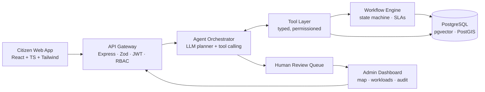

# CivicFix

**From citizen complaints to verified civic resolution.**

CivicFix is an agentic AI platform that turns unstructured citizen complaints (potholes, overflowing garbage, broken streetlights, water leaks) into prioritised, trackable work orders, and only closes a complaint once there is evidence the work was actually done.

> Built by **Team BitBros** (NITK Surathkal) for **ChronoForge 2026**: *Cities of the Future*, **Agentic AI** track.

> **Status:** 🟡 Proposal stage. The prototype will be built during the 24-hour hacking round (24–25 Oct 2026). Read the full proposal in [`docs/CivicFix_Proposal_BitBros.pdf`](docs/CivicFix_Proposal_BitBros.pdf).

---

## The problem

Reporting a civic issue is easy. Getting it fixed is not. Complaints are duplicated, misclassified, sent to the wrong department, or closed without proof. Most existing portals (FixMyStreet, SeeClickFix, Swachhata-MoHUA, BBMP Sahaaya) mainly **record and route** reports. None of them coordinates the full loop:

```
interpret → deduplicate → prioritise → assign → track → verify
```

## What CivicFix does

| Feature | Description |
|---|---|
| 🧠 **Intelligent intake** | Free-text complaints (English / Hindi / Kannada) + map pin + photo. The agent extracts the category, severity and landmarks, and asks follow-up questions when details are missing. |
| 🔁 **Duplicate clustering** | Semantic similarity + geo radius + time window groups related reports into one issue. |
| ⚖️ **Explainable prioritisation** | P1–P4 priority with a written rationale. Uncertain or sensitive cases go to a human. |
| 🏗️ **Agentic assignment** | The agent checks department responsibilities, staff availability and workload, then creates a work order with an SLA deadline. |
| 📍 **End-to-end tracking** | Reported → Under Review → Assigned → In Progress → Resolution Submitted → Verified & Resolved |
| ✅ **Resolution verification** | Before/after photo comparison (vision model) + GPS and timestamp checks. Doubtful closures are **flagged, never auto-accepted**. |
| 📜 **Audit trail** | Every agent decision, tool call, status change and human approval is logged. |

## Architecture



The LLM never touches the database directly. It **proposes** actions, and only validated tools and the workflow engine change state.

### Agent tools

| Tool | Purpose | Guardrail |
|---|---|---|
| `classify_complaint` | Category, severity, missing fields | Confidence < 0.7 → human review |
| `find_similar_complaints` | Embeddings + ~100 m radius + 14-day window | Merge only above threshold |
| `get_department_capacity` | Responsibilities, staff, workload | Read-only |
| `set_priority` | P1–P4 with rationale | P1 / sensitive → admin confirms |
| `create_work_order` | Assign team, set SLA | Invalid transitions rejected |
| `verify_resolution` | Photo + GPS/time consistency | Can only approve or flag |
| `request_human_review` | Escalate with evidence | Always allowed |

## Tech stack

- **Frontend:** React, TypeScript, Tailwind CSS, Leaflet + OpenStreetMap
- **Backend:** Node.js, Express, Zod, JWT, role-based access control
- **Database:** PostgreSQL + pgvector + PostGIS
- **AI:** tool-calling LLM, multimodal model for photo verification, embedding model for similarity (behind a provider-agnostic adapter)
- **Testing:** unit tests for tools and state transitions, scenario harness with seeded simulated city data

## Planned project structure

```
civicfix/
├── client/          # React citizen app + admin dashboard
├── server/
│   ├── api/         # Express routes, validation, auth
│   ├── agent/       # orchestrator, prompts, tool definitions
│   ├── workflow/    # state machine, SLA timers
│   └── db/          # schema, migrations, seed data
├── eval/            # labelled scenarios + rule-based baseline
└── docs/            # proposal, architecture, demo material
```

## Evaluation plan

CivicFix will be compared against a keyword-rule baseline on about 150 labelled synthetic complaints (about 20% planted duplicates and about 15 fake or insufficient resolution photos), measuring:

- Classification and department-assignment accuracy
- Duplicate-detection precision and recall
- Time from submission to work order
- Share of workflow actions completed successfully
- Resolution-verification accuracy

We will report the results we actually measure here once they exist.

## Roadmap

- [x] Proposal submitted (Round 1)
- [ ] Core app: submission, persistence, auth, admin views
- [ ] Agent workflow: classification, deduplication, prioritisation, assignment
- [ ] Verification, audit log, human-review queue
- [ ] Evaluation vs. baseline + demo
- [ ] Stretch: voice input, WhatsApp intake, hotspot prediction

## Responsible AI

- Faces and number plates blurred in uploads; minimal personal data collected
- Human-in-the-loop for low-confidence and sensitive decisions; admins can override any agent action
- Least-privilege tools, rate limiting, append-only audit log
- Demo uses **simulated** civic data only, with no real municipal systems

## Team BitBros

| Name | Roll No. |
|---|---|
| Vikash Saini | 241CV256 |
| Rishi Kumar | 241CV144 |

National Institute of Technology Karnataka (NITK), Surathkal

## License

[MIT](LICENSE). Third-party libraries, models and datasets will be credited here as they are added.
