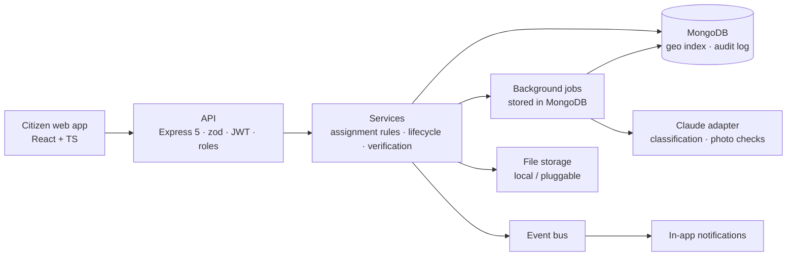

# CivicFix

**From citizen complaints to verified civic resolution.**

CivicFix is an agentic AI platform that turns unstructured citizen complaints (potholes, overflowing garbage, broken streetlights, water leaks) into prioritised, trackable work orders, and only closes a complaint once there is evidence the work was actually done.

> Built by **Team BitBros** (NITK Surathkal) for **ChronoForge 2026**: *Cities of the Future*, **Agentic AI** track.

> **Status:** 🟢 Backend complete (all 12 planned phases) with 351 automated tests passing. The citizen web app in `client/` still runs on demo data and is being connected to the API. Proposal: [`docs/CivicFixProposalBitBros.pdf`](docs/CivicFixProposalBitBros.pdf). Blueprint: [`docs/CivicFixFullDetails.pdf`](docs/CivicFixFullDetails.pdf).

---

## The problem

Reporting a civic issue is easy. Getting it fixed is not. Complaints are duplicated, misclassified, sent to the wrong department, or closed without proof. Most existing portals (FixMyStreet, SeeClickFix, Swachhata-MoHUA, BBMP Sahaaya) mainly **record and route** reports. None of them coordinates the full loop:

```
interpret → deduplicate → prioritise → assign → track → verify
```

## What CivicFix does

| Feature | What's built |
|---|---|
| 🧠 **Intelligent intake** | Citizens report with text (any language), a map pin and photos. Claude classifies category, priority and department, writes a summary, and flags missing information, all as *suggestions*. |
| 🔁 **Duplicate detection** | Reports within 150 m and 14 days with similar wording are flagged for a human; nothing is merged automatically. |
| ⚖️ **Explainable, rule-based assignment** | Clear-cut cases are routed automatically by deterministic rules (high certainty, one responsible department, no duplicates, not urgent). Everything else goes to a manager review queue with the reasons. |
| 🏗️ **Work orders** | Accept → start → block/resume → submit fix, with target dates, workload-based staff picks, notes and full history. |
| ✅ **Verified resolution** | Fix photos are checked for real file type and for signs of editing or AI generation. A manager (never the assignee) approves; "submitted" never means "resolved". |
| ⚖️ **Disputes** | Citizens can dispute a fix within 14 days; an upheld dispute reopens the work. Open disputes block closing. |
| 🔔 **Notifications and dashboards** | In-app notifications per role; dashboards for citizens, staff, managers and admins. |
| 📜 **Audit trail** | Append-only log of every sensitive action, separating human, rule (SYSTEM) and AI actors. |

The AI **never** assigns, rejects, resolves or closes anything on its own. It has no database access and no tools; its output is validated and used only as input to rules and human decisions.

## Architecture



| Layer | Technology |
|---|---|
| Backend | Node.js 24, TypeScript, Express 5, zod validation, pino logging |
| Database | MongoDB 8 via Mongoose 9 (2dsphere geo index, unique indexes for invariants) |
| Auth | Short-lived JWT access tokens + rotating HttpOnly refresh cookie, Argon2id passwords |
| AI | Claude (Anthropic SDK) behind a provider-agnostic adapter; rule-based duplicate detection |
| Frontend | React, TypeScript, Tailwind CSS, Leaflet + OpenStreetMap |
| Tests | Vitest + in-memory MongoDB, 351 tests (unit, integration, end-to-end, security) |

## Repository

```
civicfix/
├── client/          # Citizen web app (React; currently demo data)
├── server/          # Backend API, see server/README.md
│   ├── src/         # app, routes, services, models, policies, ai, storage, events
│   └── tests/       # 16 test files
└── docs/
    ├── api/         # API contracts for the frontend
    ├── ai/          # AI pipeline design and limits
    ├── DEPLOYMENT.md
    └── SECURITY_REVIEW.md
```

## Run it

```bash
cd server
npm install
cp .env.example .env        # set JWT_SECRET; optionally AI_PROVIDER=anthropic + ANTHROPIC_API_KEY
npm run db:sync-indexes
NEW_USER_PASSWORD='…' npm run user:create -- --email admin@example.org --name Admin --role PLATFORM_ADMIN
npm run dev                 # http://localhost:4000, health at /health/ready
npm test
```

Requires MongoDB 8 locally (or an Atlas URI). Details in [`server/README.md`](server/README.md) and [`docs/DEPLOYMENT.md`](docs/DEPLOYMENT.md).

## API documentation

| Area | Doc |
|---|---|
| Conventions, errors, pagination | [docs/api/API_CONVENTIONS.md](docs/api/API_CONVENTIONS.md) |
| Authentication | [docs/api/AUTHENTICATION.md](docs/api/AUTHENTICATION.md) |
| Users, departments, memberships | [docs/api/USERS_DEPARTMENTS_MEMBERSHIPS.md](docs/api/USERS_DEPARTMENTS_MEMBERSHIPS.md) |
| Complaints | [docs/api/COMPLAINTS.md](docs/api/COMPLAINTS.md) |
| Assignment and work orders | [docs/api/ASSIGNMENTS_WORK_ORDERS.md](docs/api/ASSIGNMENTS_WORK_ORDERS.md) |
| Evidence, verification, disputes | [docs/api/EVIDENCE_VERIFICATION_DISPUTES.md](docs/api/EVIDENCE_VERIFICATION_DISPUTES.md) |
| Notifications and audit log | [docs/api/NOTIFICATIONS_AUDIT.md](docs/api/NOTIFICATIONS_AUDIT.md) |
| Dashboards | [docs/api/DASHBOARDS.md](docs/api/DASHBOARDS.md) |
| AI pipeline | [docs/ai/AI_ANALYSIS_PIPELINE.md](docs/ai/AI_ANALYSIS_PIPELINE.md) |

## Responsible AI

- **Advice only:** AI output is a suggestion. Deterministic rules and humans make every privileged decision, and every one is audited.
- **Human review:** uncertain, urgent, conflicting and possibly duplicate cases go to a person. Flagged photos never auto-reject a citizen.
- **Prompt-injection defences:** complaint text is passed as data, the model has no tools and no database access, and every output is validated against a strict schema.
- **Minimal data to the AI provider:** report text and department names only. No identity or location is sent.
- **Simulated data:** the demo uses simulated civic data only, and is not connected to real municipal systems.

## Known limitations

- **AI not yet run live:** the Claude integration is tested against simulated responses. Run a live check with your API key before relying on it.
- **Single-node MongoDB:** no transactions are used. Multi-step updates are ordered and undone if a later step fails.
- **Storage and photo checks:** file storage is local disk only, and authenticity checks are heuristic (no C2PA verification, no video frame analysis).
- **Notifications** are in-app only (no email, SMS or push).

## Team BitBros

| Name | Roll No. |
|---|---|
| Vikash Saini | 241CV256 |
| Rishi Kumar | 241CV144 |

National Institute of Technology Karnataka (NITK), Surathkal

## License

[MIT](LICENSE). Third-party libraries and models are listed in `server/package.json` and `client/package.json`.
