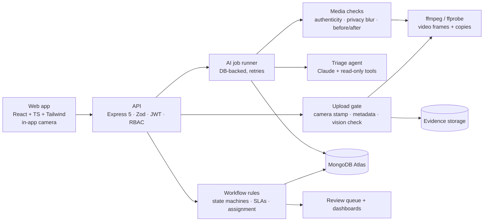

# CivicFix

**From citizen complaints to verified civic resolution.**

CivicFix is an agentic AI platform that turns citizen complaints (potholes, overflowing garbage, broken streetlights, water leaks) into prioritised, trackable work orders, and only closes a complaint once there is evidence the work was actually done.

> Built by **Team BitBros** (NITK Surathkal) for **ChronoForge 2026**: *Cities of the Future*, **Agentic AI** track.

> **Status:** 🟢 Working prototype. Backend, frontend, AI pipeline and evidence checks are implemented and tested end to end against MongoDB Atlas with live AI calls. The original proposal is in [`docs/CivicFixProposalBitBros.pdf`](docs/CivicFixProposalBitBros.pdf).

---

## The problem

Reporting a civic issue is easy. Getting it fixed is not. Complaints are duplicated, misclassified, sent to the wrong department, or closed without proof. Most existing portals (FixMyStreet, SeeClickFix, Swachhata-MoHUA, BBMP Sahaaya) mainly **record and route** reports. None of them coordinates the full loop:

```
interpret → deduplicate → prioritise → assign → track → verify
```

## What CivicFix does

| Feature | Description |
|---|---|
| 🧠 **AI triage agent** | Reads the complaint, checks the location, looks for similar complaints and available staff with read-only tools, then proposes category, priority (P1–P4), department and assignee with a written rationale. Backend rules make the final decision; unclear cases go to a human review queue. |
| 🔁 **Duplicate detection** | Semantic similarity (embeddings) + distance + time window. Likely duplicates are linked, not silently merged. |
| 🏗️ **Rule-based assignment** | Clear, confident cases are assigned automatically to an on-duty worker with capacity, with an SLA deadline. |
| 📍 **End-to-end tracking** | Reported → Under review → Assigned → Accepted → In progress → Resolution submitted → Verified → Resolved → Closed, with disputes and rework. |
| 📷 **In-app camera only** | Citizens and workers take photos and videos **inside the app**: the gallery isn't offered. Each capture is stamped with a server-signed camera session plus the time and GPS from the moment of capture. |
| 🕵️ **Fake and edited media refused** | Every photo and video is checked **before it is stored**: file metadata (AI-generator and editing-app tags, content credentials) plus a vision model. Flagged files are refused; a `strict` mode also refuses files with only some signs of editing. |
| 🎥 **Video evidence** | MP4, iPhone MOV and browser recordings (WebM, converted with ffmpeg). Frames across the clip are checked in one AI call; length, time and GPS are read from the file. |
| ✅ **Resolution verification** | Before/after comparison by a vision model, GPS within 50 m of the complaint, capture time after assignment. Doubtful resolutions go to a manager; nothing is auto-closed by AI. |
| 🔒 **Privacy** | Shareable copies of photos and videos have faces and number plates pixelated and all location/device metadata removed. Citizens' identities are hidden from departments. |
| 📜 **Audit trail** | Every AI decision, tool call, status change, upload (and refused upload) and human approval is logged. |

## Architecture



The AI never changes state directly. It **proposes**; validated backend rules and humans decide.

### Agent tools (read-only)

| Tool | Purpose |
|---|---|
| `get_location_context` | Ward, nearby schools/hospitals/main roads for priority context |
| `find_similar_complaints` | Nearby, recent, similar reports (possible duplicates) |
| `get_department_workload` | Open work per department |
| `list_available_staff` | On-duty workers with capacity |
| `request_human_review` | Send the case to the manager review queue with a reason |
| `submit_triage` | Final structured answer (validated against a schema) |

## Tech stack

- **Frontend:** React, TypeScript, Tailwind CSS, Leaflet + OpenStreetMap, Vite
- **Backend:** Node.js 22+, Express 5, Zod, JWT + refresh cookies, role-based access control, pino
- **Database:** MongoDB (Atlas) with Mongoose; geo indexes for location queries
- **AI:** Anthropic Claude (direct or through the AiCredits.in gateway) for triage, photo/video checks, privacy detection and before/after comparison; OpenAI-compatible embeddings for duplicate search
- **Media:** sharp (images), ffmpeg/ffprobe (videos)
- **Testing:** Vitest with an in-memory MongoDB (server), Testing Library (client), live end-to-end script

## Project structure

```
civicfix/
├── client/              # React app: citizens, workers, managers, admins
│   └── src/
│       ├── api/         # typed HTTP client (+ mock adapter for UI work)
│       ├── components/  # incl. CameraCapture, PhotoInput, Workflow panels
│       ├── pages/       # report, tracking, work orders, review queue, dashboards
│       └── lib/         # domain rules, media/capture helpers
├── server/              # API and AI pipeline
│   ├── src/
│   │   ├── ai/          # Claude adapter, prompts, embeddings
│   │   ├── media/       # ffmpeg video tools
│   │   ├── models/      # Mongoose schemas
│   │   ├── policies/    # complaint and work-order state machines
│   │   ├── routes/      # Express routers
│   │   ├── services/    # complaints, assignment, evidence, camera sessions, analysis runner…
│   │   └── scripts/     # seed, create user, sync indexes
│   └── tests/           # unit/integration tests + live e2e script
└── docs/                # API contracts, AI pipeline, deployment, security review
```

## Quick start

Requirements: Node 22+, a MongoDB connection string (Atlas or local), and for videos **ffmpeg + ffprobe** on the PATH.

```bash
# 1. API
cd server
npm install
cp .env.example .env        # set MONGODB_URI, JWT_SECRET; AI keys optional
npm run db:seed             # demo city, departments, staff and ~150 complaints (password: SEED_PASSWORD)
npm run dev                 # http://localhost:4000

# 2. Web app (second terminal)
cd client
npm install
npm run dev                 # http://localhost:5173 (proxies /api to :4000)
```

Demo accounts after seeding (password from `SEED_PASSWORD`, kept in the git-ignored `server/.seed-credentials`):

| Role | Email |
|---|---|
| Platform admin | `admin@civicfix.local` |
| Citizen | `citizen@civicfix.local`, `resident01..25@civicfix.local` |
| Department manager | `roads.manager@`, `sanitation.manager@`, `electrical.manager@`, `water.manager@`, `drainage.manager@`, `general.manager@civicfix.local` |
| Field worker | `<department>.worker1@civicfix.local`, `…worker2@`, … |

New citizens can also sign up at `/register`.

> **Camera on phones:** browsers only allow the camera and GPS on **HTTPS** pages (or `localhost`). To test on a phone, deploy behind HTTPS or use an HTTPS tunnel. Without it the app falls back to the phone's own camera app and only accepts a file taken moments ago.

## Key settings (`server/.env`)

| Variable | Default | What it does |
|---|---|---|
| `AI_PROVIDER` | `disabled` | `anthropic` turns on AI triage and media checks |
| `AICREDITS_API_KEY` / `ANTHROPIC_API_KEY` | none | One of them, when AI is on |
| `AI_MODEL` | `claude-opus-5-5` | Model ID (AiCredits uses IDs like `anthropic/claude-opus-5.5`) |
| `AI_TRIAGE_MODE` | `single` | `agent` = tool-using triage agent (more calls, better routing) |
| `EVIDENCE_CAPTURE` | `camera` | `camera` = in-app camera only; `any` = gallery files allowed too |
| `MEDIA_UPLOAD_GATE` | `block` | `strict` = also refuse "some signs" of editing; `block` = refuse flagged files; `flag` = store and mark for review |
| `MAX_VIDEO_SECONDS` | `60` | Longest accepted video |
| `FFMPEG_PATH` / `FFPROBE_PATH` | `ffmpeg` / `ffprobe` | Video tools; without them videos get metadata checks only |
| `STORAGE_PROVIDER` | `disabled` | `local` stores evidence under `STORAGE_LOCAL_DIR` |
| `GEOCODER` | `nominatim` | Street addresses for map points from OpenStreetMap; `disabled` = ward and nearby landmark only |

All settings: [`server/README.md`](server/README.md) and [`server/.env.example`](server/.env.example).

## Testing

```bash
cd server && npm test            # ~430 tests, in-memory MongoDB; video tests run when ffmpeg is installed
cd client && npm test            # ~150 tests
cd server && npm run e2e:live    # full journey against the running server (real AI calls when AI is on)
```

`e2e:live` checks that gallery files and drawn/AI-looking photos are refused. To run the rest of the journey it needs two real camera JPEGs: `E2E_BEFORE_PHOTO=… E2E_AFTER_PHOTO=… npm run e2e:live`.

## Documentation

| Topic | Where |
|---|---|
| API conventions and every endpoint | [`docs/api/`](docs/api/) |
| AI pipeline (triage agent, duplicates, media checks) | [`docs/ai/AI_ANALYSIS_PIPELINE.md`](docs/ai/AI_ANALYSIS_PIPELINE.md) |
| Evidence, camera capture, verification, disputes | [`docs/api/EVIDENCE_VERIFICATION_DISPUTES.md`](docs/api/EVIDENCE_VERIFICATION_DISPUTES.md) |
| Deployment and security | [`docs/DEPLOYMENT.md`](docs/DEPLOYMENT.md), [`docs/SECURITY_REVIEW.md`](docs/SECURITY_REVIEW.md) |
| Server internals | [`server/README.md`](server/README.md) |
| Client internals | [`client/README.md`](client/README.md) |

## Roadmap

- [x] Proposal submitted (Round 1)
- [x] Core app: submission, persistence, auth, roles, dashboards
- [x] Agent workflow: classification, deduplication, prioritisation, assignment
- [x] Verification, disputes, audit log, human-review queue
- [x] Real-media rules: in-app camera, upload-time fake/edit checks, video evidence, privacy blur
- [ ] Deployment behind HTTPS (needed for the phone camera)
- [ ] AI cost controls (cheaper model for media checks, daily spend cap)
- [ ] Evaluation vs. a keyword-rule baseline
- [ ] Stretch: voice input, WhatsApp intake, hotspot prediction

## Responsible AI

- AI only proposes; deterministic rules and people decide. Every AI decision and tool call is logged.
- Uncertain, high-priority or sensitive cases go to a human. Admins can re-run the AI or override it.
- Media checks report *signals*, not proof. "No suspicious signals" never means "verified genuine", and the camera stamp raises the bar but can't stop a determined attacker.
- Faces and number plates are blurred in shared copies; metadata is stripped; reporters are anonymous to departments.
- Demo uses **simulated** civic data only, with no real municipal systems.

## Team BitBros

| Name | Roll No. |
|---|---|
| Vikash Saini | 241CV256 |
| Rishi Kumar | 241CV144 |

National Institute of Technology Karnataka (NITK), Surathkal

## License

[MIT](LICENSE). Uses Anthropic Claude, OpenStreetMap/Leaflet, ffmpeg and the open-source libraries listed in each `package.json`.
